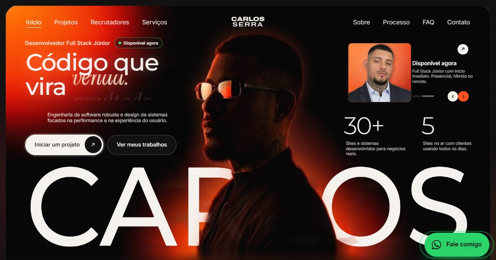

# Carlos Serra · Desenvolvedor Full Stack Júnior

Landing page pessoal de **Carlos Alberto Araújo Serra Nunes**, feita para dois objetivos: conseguir uma vaga de **Desenvolvedor Full Stack Júnior** (junho de 2027, qualquer modalidade) e **captar donos de pequenos negócios** que precisam de site, cardápio digital ou sistema com pedido no WhatsApp.

**Site:** https://carlosserra-a11y.github.io/LeadPageDevCarlos/



## O que tem na página

- **Hero em Full HD com a sua imagem** (no computador), montado em camadas: fundo ampliado 4× com IA (Swin2SR, rodando no PC), o nome **CARLOS inteiro em vetor** (nítido em qualquer tela), você recortado na frente e o degradê continuando até o fim do hero. Menu real por cima, textos corrigidos e áreas clicáveis sobre os botões da imagem. Título **"Código que vira cliente."** com a última palavra girando (pedido, venda, resultado) e a sua foto nova no cartão. Animações: entrada em sequência (fundo → nome → você), brilho que percorre o nome, luz que respira atrás de você, profundidade com o mouse (cada camada se move numa distância) e paralaxe na rolagem. No celular, a versão montada a partir dela (retrato de perfil na frente do nome **CARLOS**, cartão de destaques e **selo giratório** que acelera com a rolagem).
- **Paralaxe** no hero (rolagem e mouse), faixa de tecnologias que inverte com a direção da rolagem, manifesto que acende palavra por palavra e fotos com revelação por máscara.
- **Portfólio logo depois do hero**, em anel 3D giratório: a rolagem gira o anel com os 8 projetos reais (capturas dos sites no ar, em alta resolução 2×). Também gira com setas, teclado (← → Home End), clique e arrasto.
- **Para recrutadores logo depois dos projetos**: disponível com início imediato, destaque **Especialista em Claude Code**, stack e diferenciais.
- **Serviços como vitrine**: cada serviço abre mostrando um projeto real, o que vem incluso, prazo e o botão "Quero um orçamento disso".
- **Pacotes a partir de R$ 500** (Essencial, Profissional e Sob medida), com **30 dias de garantia** para ajustes e bugs e **demonstração ao vivo** na entrega. O botão "Quero este" já leva o pacote para o orçamento.
- Números reais no hero: **30+ sites feitos** e **5 no ar com clientes usando**.
- **Currículo em PDF** para recrutadores (botão na seção de recrutadores e no rodapé).
- **Avaliações no Google** e **Google Analytics com aviso de cookies (LGPD)**, prontos para ligar no `config.js`.
- Processo, condições e FAQ para **clientes**.
- **WhatsApp (48) 99617-0281**, **e-mail** e **Instagram** no contato e no rodapé, e um **botão flutuante do WhatsApp** visível na página inteira.
- **Abertura animada**: o nome se "decodifica" a partir de símbolos de código e um anel laranja abre o hero.
- Hero no computador com **textos e botões reais** (rótulo, botões, 100%/360°, setas): nítidos em qualquer tela.
- **Fundo vivo** em todo o site: luzes carmim flutuando e brasas subindo, que aceleram com a rolagem.
- **No celular, o portfólio gira deslizando para os lados** (sem prender a rolagem); no computador, gira com a rolagem, o mouse ou o trackpad.
- **Orçamento em 4 etapas** (o que precisa → negócio → detalhes → conferir) que monta a mensagem organizada e abre o WhatsApp ou o e-mail. Recrutadores têm uma etapa só. Nada é salvo nem enviado a servidor.

## Como editar

| Quero mudar… | Mexo em… |
|---|---|
| WhatsApp, e-mail, LinkedIn, Instagram | `assets/js/config.js` (campo vazio = botão escondido) |
| Textos de qualquer seção | `index.html` (cada seção tem um comentário com o nome dela) |
| Um projeto do portfólio | `index.html`, seção `PROJETOS`: cada `<li class="ring__card">` é um projeto (título, descrição, tecnologias e links). O painel lê tudo de lá. |
| A captura de um projeto | troque as duas imagens em `assets/img/projects/`: `nome.webp` (960 × 600) e `nome-1600.webp` (1600 × 1000), em WebP |
| A disponibilidade | procure por "Disponível agora" e "INÍCIO IMEDIATO" no `index.html` |
| Ícone da aba e do celular | `assets/img/favicon-*.png`, `icon-*.png` e `favicon.svg` |
| Cores | variáveis no topo de `assets/css/base.css` (`--ember`, `--crimson`, `--red`…) |
| Tempo de troca do cartão do hero | `heroCardInterval` em `assets/js/config.js` |
| A imagem do hero no computador | camadas em `assets/img/hero/`: `hero-fundo-2560/1440.webp` (fundo sem as letras) e `hero-pessoa-1400/800.webp` (você recortado). O nome é texto vetorial no `index.html` (`hero-art__name`). Posições em `assets/css/hero-art.css` |
| A foto do hero no celular | `assets/img/hero/carlos-perfil-1300.webp` e `-900.webp` |
| Textos por cima da arte (título, subtítulo, cartão, legendas) | bloco `hero-art` no `index.html` |
| Palavras que giram no título | `rotator__word` no `index.html` (duas vezes: computador e celular) |
| Foto do cartão do hero | `assets/img/hero/carlos-card.webp` (600 × 600) |
| Um serviço (texto, itens, captura) | `index.html`, seção `SERVIÇOS`: cada `<details class="offer">` |
| Pacotes e preços | `index.html`, bloco `pacotes` (dentro de SERVIÇOS) |
| Currículo | edite `scripts/curriculo.html` e gere o PDF no Chrome (Ctrl+P → Salvar como PDF, A4, sem margens, com gráficos de fundo) em `assets/docs/curriculo-carlos-serra.pdf` |
| Link de avaliação no Google | `googleReview` em `assets/js/config.js` (vazio = botão escondido) |
| Google Analytics | `analytics.googleId` em `assets/js/config.js` (ID `G-…`; vazio = nada carrega) |
| Opções do orçamento | `index.html`, `<form data-contact-form>`; a mensagem é montada em `assets/js/lib/message.js` |
| Prévia do link no WhatsApp/LinkedIn | `assets/img/og.jpg` (1200 × 630) e as tags `og:` no `<head>` |

## Rodar no computador

```bash
npm start
```

Abra http://localhost:5173/LeadPageDevCarlos/ (servidor sem cache, sem dependências).

```bash
npm test
```

Roda os testes da lógica pura (montagem da mensagem, validação e matemática do anel 3D) com o executor nativo do Node.

## Publicar no GitHub Pages

O site é publicado a partir da branch **`gh-pages`** (o GitHub ativou o Pages sozinho quando ela foi enviada). Depois de editar e salvar na `main`, publique assim:

```bash
git push origin main
```

```bash
git push origin main:gh-pages
```

Em 1 a 2 minutos a nova versão aparece em https://carlosserra-a11y.github.io/LeadPageDevCarlos/.

Se preferir publicar direto da `main` (um comando só), em **Settings → Pages** troque a branch para **`main`**, pasta **`/ (root)`**, e salve. O arquivo `.nojekyll` já está na raiz, então o GitHub serve tudo como está.

## Confira antes de divulgar

- [x] WhatsApp preenchido em `assets/js/config.js`.
- [x] E-mail e Instagram preenchidos em `assets/js/config.js`.
- [ ] Preencher `linkedin` (recrutadores procuram).
- [x] Disponibilidade: início imediato.
- [ ] Testar o link no WhatsApp (a prévia deve mostrar o hero).
- [ ] Conferir se todos os 8 projetos continuam no ar.

## Tecnologia

HTML, CSS e JavaScript puros (módulos ES), **sem etapa de build**. Animações com **GSAP 3 + ScrollTrigger** e rolagem suave com **Lenis**, servidos pelo próprio site (`assets/vendor/`). Fontes auto-hospedadas. CSP estrita (sem script ou estilo inline), respeito a `prefers-reduced-motion`, funciona sem JavaScript.

```
index.html            página
404.html              página de erro do GitHub Pages
assets/css/           base, hero, seções, portfólio, contato
assets/js/boot.js     marca JS/movimento reduzido antes de pintar
assets/js/config.js   contatos e ajustes editáveis
assets/js/main.js     liga cada parte, isolando falhas
assets/js/modules/    hero, anel 3D, rolagem, navegação, contato, efeitos
assets/js/lib/        lógica pura testada (mensagem, matemática do anel)
tests/                testes (node --test)
scripts/serve.mjs     servidor local sem cache
PROMPT.md             o prompt mestre usado para criar a página
ANALISE.md            análise final: bugs corrigidos e melhorias sugeridas
```

## Créditos

- [GSAP](https://gsap.com) (licença padrão GreenSock, gratuita) · [Lenis](https://github.com/darkroomengineering/lenis) (MIT)
- Fontes: Archivo, Inter, Instrument Serif e Montserrat (SIL Open Font License)
- Fotos: do próprio Carlos. Capturas: dos sites dos projetos, feitas por ele.

© 2026 Carlos Alberto Araújo Serra Nunes. Código e imagens deste repositório não podem ser reutilizados sem autorização.
